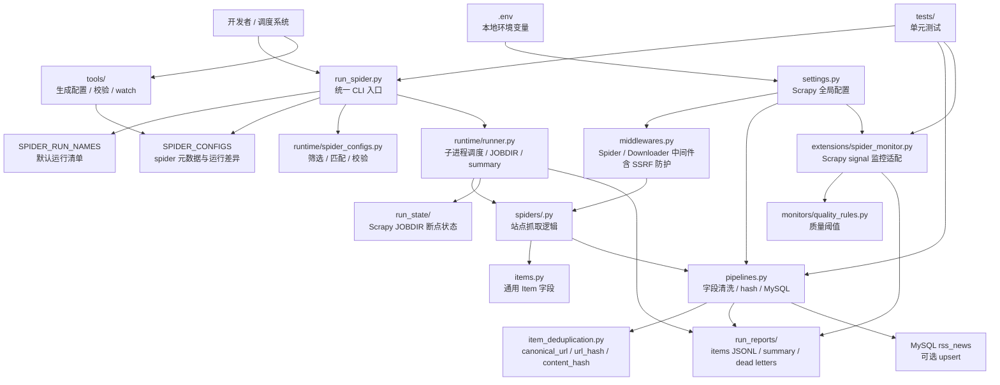
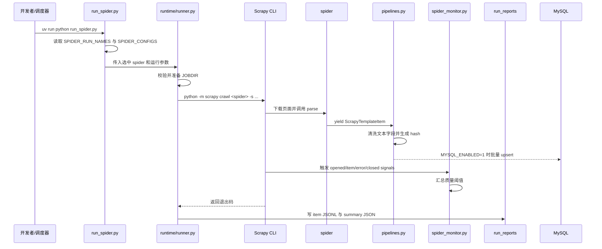

# app

`app` 是一个基于 `uv` 管理的 Scrapy 爬虫工程模板。它面向“多站点、可续跑、可观测、可入库”的采集任务，不是单个临时爬虫脚本。

项目的核心思想是：`run_spider.py` 作为统一运行入口维护 spider 运行清单；Scrapy 负责抓取调度；项目内的 runtime、pipeline、monitor、tools 模块分别承担读取配置、运行调度、字段清洗、去重入库、质量监控和开发辅助。

## 1. 项目概述

| 项目项 | 说明 |
| --- | --- |
| 项目名称 | `app` |
| 项目类型 | Python Scrapy 爬虫模板 / CLI 工具 |
| 运行入口 | `run_spider.py` |
| 核心能力 | spider 运行清单、断点续跑、运行摘要、JSONL 导出、字段清洗、URL 去重、可选 MySQL upsert、spider-monitor 运行监控、配置校验 |
| 包管理 | `uv` |
| Python 版本 | `>=3.12` |
| 数据库 | MySQL 可选；项目不自动建表，建表契约见 `docs/database-contract.md` |
| 当前示例 spider | `example`，抓取 `https://quotes.toscrape.com/` |

适用场景：

- 新增多个站点 spider，并通过一个统一入口批量运行。
- 需要保留 Scrapy `JOBDIR` 状态，支持失败后续跑。
- 需要将标准化后的 item 写入 JSONL 或 MySQL。
- 需要基础运行监控、质量阈值和失败摘要，方便排查生产采集任务。

## 2. 项目架构图



运行数据流：



## 3. 技术栈

| 分类 | 技术 |
| --- | --- |
| 语言 | Python 3.12+ |
| 爬虫框架 | Scrapy 2.16+ |
| 包管理 | uv |
| 配置加载 | python-dotenv |
| 数据库驱动 | PyMySQL |
| 运行监控 | spider-monitor `[scrapy]` |
| 数据输出 | Scrapy feed export JSONL、可选 MySQL |
| 测试 | unittest，项目也声明了 pytest 作为开发依赖 |
| 代码检查 | ruff |
| 依赖审计 | pip-audit |
| 容器化 | Docker，基础镜像 `python:3.12-slim` |
| CI | GitHub Actions，覆盖 Windows 与 Ubuntu |

## 4. 项目目录结构

```text
app/
├── run_spider.py                         # 统一运行入口；维护 SPIDER_RUN_NAMES / SPIDER_CONFIGS
├── scrapy.cfg                            # Scrapy 项目配置，默认 settings 指向 app.settings
├── pyproject.toml                        # uv 项目元数据与依赖声明
├── uv.lock                               # uv 锁定文件
├── .python-version                       # Python 版本提示
├── .env.example                          # 环境变量模板；复制为 .env 使用
├── .gitignore                            # 忽略本地环境、运行状态和抓取产物
├── Dockerfile                            # 容器镜像构建配置
├── .dockerignore                         # Docker 构建上下文排除规则
├── .github/
│   └── workflows/
│       └── test.yml                      # CI：依赖安装、lint、审计、测试、编译、配置校验、dry-run
├── docs/
│   ├── database-contract.md              # MySQL 表结构与写入契约
│   ├── mcp-usage.md                      # 本地 MCP 工具说明
│   └── project-overview.md               # 架构补充说明
├── migrations/
│   └── mysql/
│       └── 001_create_rss_news.sql       # MySQL 建表示例
├── app/
│   ├── __init__.py
│   ├── settings.py                       # Scrapy 全局配置与 .env 映射
│   ├── items.py                          # 通用 item 字段定义
│   ├── pipelines.py                      # 字段清洗、hash、MySQL 批量写入和死信
│   ├── middlewares.py                    # Scrapy 中间件，含下载请求 SSRF 防护
│   ├── item_deduplication.py             # URL 规范化、url_hash、content_hash
│   ├── runtime/
│   │   ├── __init__.py
│   │   ├── runner.py                     # 子进程运行、JOBDIR 安全、日志、summary
│   │   └── spider_configs.py             # spider 配置筛选、匹配和校验
│   ├── spiders/
│   │   ├── __init__.py
│   │   └── example.py                    # 示例 spider
│   ├── extensions/
│   │   ├── __init__.py
│   │   └── spider_monitor.py             # spider-monitor Scrapy 扩展
│   └── monitors/
│       ├── __init__.py
│       └── quality_rules.py              # 采集质量阈值规则
├── tools/
│   ├── build_spider_configs.py           # 根据已注册 spider 生成 SPIDER_CONFIGS 候选
│   ├── validate_spider_configs.py        # 校验 run_spider.py 中的配置
│   └── watch_spiders.py                  # 监听文件变更后自动执行命令
└── tests/
    ├── test_build_spider_configs.py
    ├── test_downloader_middleware.py
    ├── test_item_deduplication.py
    ├── test_mysql_pipeline.py
    ├── test_run_spider_jobdir_modes.py
    ├── test_run_spider_selection.py
    ├── test_spider_monitor_extension.py
    └── test_validate_spider_configs.py
```

本地运行目录：

- `run_state/`：Scrapy `JOBDIR` 断点状态，仅本地或运行环境使用。
- `run_reports/`：运行摘要、item JSONL、MySQL dead letter 文件，仅本地或运行环境使用。
- `.env`：本地密钥与环境差异，不提交。
- `.venv/`、`.codegraph/`、`.codex/mcp/`：本地工具或索引目录，不属于运行产物。

## 5. 核心模块/分层说明

### 5.1 入口层：`run_spider.py`

`run_spider.py` 是项目的统一运行入口，日常运行优先使用它，而不是直接散落执行多个 `scrapy crawl` 命令。

核心配置：

- `SPIDER_CONFIGS`：由 `app/runtime/spider_configs.discover_spider_configs()` 扫描 Scrapy spider loader 自动生成，覆盖 `app/spiders/` 下全部扁平站点 spider（`NNN_<host>.py`）及 `example`，字段包括 `spider`、`file`、`start_urls`、`jobdir`、`timeout_seconds`、`settings`。
- `SPIDER_RUN_NAMES`：默认运行清单，即除 `example` 外的全部扁平站点 spider；值必须匹配 `SPIDER_CONFIGS` 中的 `name`。

常用参数：

```bash
uv run python run_spider.py --dry-run
uv run python run_spider.py --spider example
uv run python run_spider.py --fresh
uv run python run_spider.py --resume
uv run python run_spider.py --limit 1 --offset 0
uv run python run_spider.py --skip example
uv run python run_spider.py --available-only
uv run python run_spider.py --stop-on-failure
uv run python run_spider.py --setting DOWNLOAD_DELAY=1
```

小批次运行直接用 `run_spider.py` 的 `--limit` / `--offset` 或 `--spider` 控制：

```bash
uv run python run_spider.py --limit 5 --offset 0
uv run python run_spider.py --spider 120_zgznh_com --spider 059_nhc_gov_cn
```

网络失败来源先运行端点侦察，再决定补 RSS/sitemap/API 或移出清单：

```bash
uv run python tools/discover_source_endpoints.py
uv run python tools/probe_pagination.py
```

### 5.2 运行层：`app/runtime/`

`runtime/runner.py` 负责把选中的配置转换为 Scrapy 子进程命令，并管理运行状态。

主要职责：

- 为每个 spider 准备安全的 `JOBDIR`，防止状态目录逃逸到 `run_state/` 之外。
- 支持 `--fresh` 清理旧状态，支持默认续跑。
- 对每个 spider 设置超时时间。
- 将输出写到 `run_reports/items/<spider>.jsonl`。
- 生成 `run_reports/<run_id>/summary.json` 与每个 spider 的独立 summary。

`runtime/spider_configs.py` 负责配置筛选与校验：

- 根据 name、title、URL、文件路径或 glob 规则匹配 spider。
- 发现 Scrapy 当前可用 spider。
- 校验配置重复、缺失、URL 非法、文件不存在等问题。

### 5.3 Scrapy 配置层：`app/settings.py`

`settings.py` 是 Scrapy 全局配置入口，并从 `.env` 读取环境差异。

当前默认策略：

- 遵守 `robots.txt`：`ROBOTSTXT_OBEY=True`。
- 默认并发：`CONCURRENT_REQUESTS=16`，`CONCURRENT_REQUESTS_PER_DOMAIN=8`。
- 默认下载延迟：`DOWNLOAD_DELAY=0.5`。
- 启用 AutoThrottle。
- 启用 Scrapy retry，覆盖 `408/429/5xx`。
- 默认关闭 HTTP cache，可通过 `.env` 开启。
- 启用自定义 downloader middleware、pipeline 和 spider-monitor extension。

### 5.4 Spider 层：`app/spiders/`

每个站点 spider 放在 `app/spiders/`。当前示例 `example.py` 展示了最小实现：

- 定义 `name`、`allowed_domains`、`start_urls`。
- 在 `parse()` 中解析页面并 `yield ScrapyTemplateItem`。
- 通过 `response.follow()` 跟进分页。

新增或重命名扁平站点 spider 后，无需手工维护配置：`run_spider.py` 会通过 `discover_spider_configs()` 自动发现，`SPIDER_CONFIGS` 与 `SPIDER_RUN_NAMES` 随 `scrapy list` 结果动态生成。可用 `tools/validate_spider_configs.py --check-available` 校验。

### 5.5 Item 与去重层

`items.py` 定义通用字段：

- 基础字段：`title`、`url`、`canonical_url`
- 去重字段：`url_hash`、`content_hash`
- 内容字段：`content`、`content_md`、`summary`
- 来源字段：`source`、`source_site`、`source_category`、`domain`
- 辅助字段：`publish_time`、`author`、`image_url`、`raw_item`、`crawled_at`

`item_deduplication.py` 会：

- 将 URL 转为绝对地址并规范化 scheme、host。
- 移除常见追踪参数，例如 `utm_*`、`spm`、`timestamp`。
- 对规范化 URL 生成 `url_hash`。
- 对正文、Markdown 或摘要生成 `content_hash`。

### 5.6 Pipeline 层：`app/pipelines.py`

`ScrapyTemplatePipeline`：

- 清理文本字段前后空白。
- 可配置是否丢弃缺少 URL 的 item。
- 自动补充 `canonical_url`、`url_hash`、`content_hash`。

`MySQLItemPipeline`：

- 默认关闭，通过 `MYSQL_ENABLED=1` 开启。
- 按 `MYSQL_BATCH_SIZE` 批量写入。
- 使用 `ON DUPLICATE KEY UPDATE` 基于 `url_hash` 做 upsert。
- 将 `publish_time` 标准化为 MySQL `DATETIME(3)`。
- 写入失败时可生成 dead letter，默认不包含完整行数据，避免泄露敏感字段。
- 支持 transient MySQL 错误重试，配置项为 `MYSQL_RETRY_TIMES` 与 `MYSQL_RETRY_BACKOFF_SECONDS`。

MySQL 表结构不由爬虫自动创建。开启 MySQL 前必须先执行 `migrations/mysql/001_create_rss_news.sql`，并保持它与 `docs/database-contract.md`、`MySQLItemPipeline.COLUMNS` 一致。

### 5.7 中间件层：`app/middlewares.py`

项目包含 Scrapy spider middleware 与 downloader middleware。Downloader middleware 中包含 SSRF 防护：

- 默认开启：`SSRF_PROTECTION_ENABLED=true`
- 默认阻止 private、loopback、link-local、reserved、multicast 等地址。
- 如确实需要访问内网或本地地址，应通过 `SSRF_ALLOWED_HOSTS` 做显式 allowlist。

### 5.8 监控层：`app/extensions/spider_monitor.py`

该扩展连接 Scrapy signals：

- `spider_opened`
- `item_scraped`
- `item_dropped`
- `spider_error`
- `spider_closed`

它会向 `spider-monitor` 上报运行生命周期、item 事件、错误和质量结果。非本地环境下，如果设置了 `SPIDER_MONITOR_ENDPOINT`，必须使用 HTTPS。

质量阈值由 `.env` 控制：

- `SPIDER_MONITOR_MIN_ITEMS`
- `SPIDER_MONITOR_MAX_DROPPED`
- `SPIDER_MONITOR_MAX_SPIDER_ERRORS`
- `SPIDER_MONITOR_MAX_DB_ERRORS`
- `SPIDER_MONITOR_FAIL_ON_QUALITY_ERROR`

### 5.9 工具层：`tools/`

| 工具 | 用途 |
| --- | --- |
| `build_spider_configs.py` | 扫描 Scrapy 已注册 spider，打印 `SPIDER_CONFIGS` 配置候选（现已自动发现，主要用于核对） |
| `validate_spider_configs.py` | 校验 `SPIDER_CONFIGS` 与 `SPIDER_RUN_NAMES` 是否一致 |
| `watch_spiders.py` | 监听 spider、配置、工具文件变更，并自动执行指定命令 |

## 6. 如何本地运行项目

### 6.1 环境准备

安装：

- Python 3.12+
- uv
- 可选：MySQL 8.x 或兼容版本
- 可选：Docker

确认版本：

```bash
python --version
uv --version
```

### 6.2 安装依赖

```bash
uv sync
```

该命令会根据 `pyproject.toml` 和 `uv.lock` 创建或更新 `.venv/`。

### 6.3 配置环境变量

复制模板：

```bash
cp .env.example .env
```

Windows PowerShell：

```powershell
Copy-Item .env.example .env
```

最小本地配置可以保持默认值。默认 `MYSQL_ENABLED=0`，不会连接 MySQL。

常用配置项：

```dotenv
LOG_LEVEL=INFO
HTTPCACHE_ENABLED=false
SSRF_PROTECTION_ENABLED=true
SSRF_ALLOWED_HOSTS=

MYSQL_ENABLED=0
MYSQL_HOST=127.0.0.1
MYSQL_PORT=3306
MYSQL_DATABASE=crawler
MYSQL_USER=root
MYSQL_PASSWORD=
MYSQL_TABLE=rss_news
MYSQL_BATCH_SIZE=100
MYSQL_FAIL_ON_ERROR=1
MYSQL_RETRY_TIMES=0
MYSQL_RETRY_BACKOFF_SECONDS=1.0

SPIDER_MONITOR_ENABLED=1
SPIDER_MONITOR_ENV=local
SPIDER_MONITOR_ENDPOINT=
```

### 6.4 验证项目配置

```bash
uv run scrapy list
uv run python tools/validate_spider_configs.py --check-available
uv run python run_spider.py --dry-run
```

预期至少能看到 `example` spider，并且 dry-run 返回成功。

### 6.5 运行示例 spider

通过统一入口运行：

```bash
uv run python run_spider.py --spider example
```

直接使用 Scrapy 运行：

```bash
uv run scrapy crawl example -O output.json
```

运行后常见输出：

```text
run_reports/
├── items/
│   └── example.jsonl
└── <run_id>/
    ├── summary.json
    └── spiders/
        └── example.json
```

### 6.6 fresh 与 resume

默认行为偏向续跑，Scrapy 会使用 `run_state/<spider>` 中的 `JOBDIR` 状态。

清理旧状态重新运行：

```bash
uv run python run_spider.py --fresh --spider example
```

显式续跑：

```bash
uv run python run_spider.py --resume --spider example
```

### 6.7 开启 MySQL 写入

1. 创建数据库。

```sql
CREATE DATABASE crawler CHARACTER SET utf8mb4 COLLATE utf8mb4_unicode_ci;
```

2. 执行迁移脚本。

```bash
mysql -h 127.0.0.1 -u root -p crawler < migrations/mysql/001_create_rss_news.sql
```

3. 修改 `.env`。

```dotenv
MYSQL_ENABLED=1
MYSQL_HOST=127.0.0.1
MYSQL_PORT=3306
MYSQL_DATABASE=crawler
MYSQL_USER=root
MYSQL_PASSWORD=your_password
MYSQL_TABLE=rss_news
```

4. 运行 spider。

```bash
uv run python run_spider.py --spider example
```

### 6.8 Kafka → MySQL 消费

把 Kafka topic 中的新闻消息消费并 upsert 到 MySQL `rss_news` 表（与 spider 共用同一套入库/去重逻辑，主键仍是 `url_hash`）。

1. 修改 `.env`。

```dotenv
KAFKA_BOOTSTRAP_SERVERS=172.16.4.182:9092
KAFKA_TOPIC=news_pipeline
KAFKA_GROUP_ID=news-pipelines-rss-consumer
KAFKA_AUTO_OFFSET_RESET=earliest
```

同时保持 `MYSQL_ENABLED=1` 并配置好 MySQL 连接。

2. 先 dry-run 预览映射结果（不写 MySQL、不提交 offset）。

```bash
uv run python tools/kafka_consume.py --dry-run --max-messages 5
```

3. 正式消费。默认持续消费直到 Ctrl+C 退出；`--max-messages` 用于消费指定条数后退出。

```bash
uv run python tools/kafka_consume.py
uv run python tools/kafka_consume.py --max-messages 1000
```

4. 可选：topic 不存在时自动创建。

```bash
uv run python tools/kafka_consume.py --ensure-topic --topic news_pipeline
```

消息按 JSON 解析，`ctime`（Unix 秒）会自动转换为 `publish_time`（`DATETIME(3)`），其余字段（`title`/`url`/`content`/`content_md`/`author`/`domain`/`image_url`/`site_name` 等）沿用 MySQL 管线的清洗与 hash 规则。offset 只在对应批次成功落库后提交，崩溃重跑不会丢数据（at-least-once）。

### 6.9 常见问题

`scrapy list` 找不到 spider：

- 确认 spider 文件位于 `app/spiders/`。
- 确认 spider 类继承 `scrapy.Spider`，并设置唯一 `name`。
- 确认 `scrapy.cfg` 的 default settings 是 `app.settings`。

`run_spider.py --dry-run` 提示未选中 spider：

- 确认 `SPIDER_RUN_NAMES` 中的 name 已在 `SPIDER_CONFIGS` 配置。
- 临时允许空运行可使用 `--allow-empty`，但生产调度不建议这样做。

MySQL 写入失败：

- 确认 `MYSQL_ENABLED=1`。
- 确认表结构已按 `migrations/mysql/001_create_rss_news.sql` 创建。
- 查看 `run_reports/mysql_dead_letters/` 是否有失败批次。
- 生产环境可以设置 `MYSQL_RETRY_TIMES=2`，处理连接闪断、deadlock、lock wait timeout 等 transient 错误。

spider-monitor 上报失败：

- 本地可保持 `SPIDER_MONITOR_ENDPOINT=`。
- 非本地环境中，`SPIDER_MONITOR_ENDPOINT` 必须是 HTTPS。
- 如需要严格失败策略，设置 `SPIDER_MONITOR_FAIL_ON_ERROR=1`。

## 7. 开发流程与规范

### 7.1 分支管理

建议采用：

- `main`：可运行、可发布分支。
- `feature/<topic>`：新增 spider、能力扩展。
- `fix/<topic>`：缺陷修复。
- `docs/<topic>`：文档调整。

合并前至少通过本地测试与配置校验。

### 7.2 代码规范

- 入口脚本保持薄：`run_spider.py` 只维护运行清单、CLI 参数和调度入口。
- 可复用逻辑放入 `app/` 包内，不放在 `tools/` 或 spider 文件里。
- 新 spider 只写站点解析逻辑；通用清洗、去重、入库逻辑放 pipeline。
- 本地环境差异放 `.env`，不要硬编码数据库密码、监控 endpoint、代理等敏感配置。
- `scrapy.cfg` 保持 ASCII 注释，避免 Windows 中文系统编码导致 Scrapy 解析失败。

### 7.3 测试与检查

常规检查：

```bash
uv run python -m unittest discover -s tests -v
uv run python -m compileall run_spider.py app tools tests
uv run python tools/validate_spider_configs.py --check-available
uv run python run_spider.py --dry-run
```

Lint 与依赖审计：

```bash
uv run --with ruff ruff check run_spider.py app tools tests
uv run --with pip-audit pip-audit
```

新增或重命名 spider 后：

```bash
uv run python tools/build_spider_configs.py
uv run python tools/validate_spider_configs.py --check-available
```

### 7.4 提交规范

推荐使用清晰的 Conventional Commits 风格：

```text
feat(spider): add example source crawler
fix(pipeline): handle invalid publish_time as null
test(runtime): cover empty spider selection
docs(readme): add deployment guide
chore(ci): add dependency audit
```

### 7.5 测试覆盖建议

已有测试覆盖：

- spider 配置生成与校验
- `run_spider.py` 选择逻辑与 `JOBDIR` 模式
- downloader middleware SSRF 防护
- item 去重 hash
- MySQL pipeline
- spider-monitor extension

新增共享逻辑时优先补单元测试；新增 spider 时至少保留样例 HTML 或解析断言，避免目标站点变化后无法定位问题。

## 8. 部署方式

### 8.1 Docker 部署

构建镜像：

```bash
docker build -t scrapy-template:local .
```

运行 dry-run：

```bash
docker run --rm scrapy-template:local python run_spider.py --dry-run
```

挂载本地配置与运行目录：

```bash
docker run --rm \
  --env-file .env \
  -v "$(pwd)/run_state:/app/run_state" \
  -v "$(pwd)/run_reports:/app/run_reports" \
  scrapy-template:local \
  python run_spider.py --spider example
```

Windows PowerShell 示例：

```powershell
docker run --rm `
  --env-file .env `
  -v "${PWD}\run_state:/app/run_state" `
  -v "${PWD}\run_reports:/app/run_reports" `
  scrapy-template:local `
  python run_spider.py --spider example
```

镜像特性：

- 基于 `python:3.12-slim`。
- 使用 `uv sync --locked --no-dev` 安装生产依赖。
- 使用非 root 用户 `appuser` 运行。
- 将 `/app/run_state` 与 `/app/run_reports` 声明为 volume。

### 8.2 服务器定时任务

示例 crontab：

```cron
0 * * * * cd /opt/app && /usr/local/bin/uv run python run_spider.py --stop-on-failure >> run_reports/cron.log 2>&1
```

建议：

- `.env` 放在服务器安全路径或项目根目录，权限限制为运行用户可读。
- `run_state/` 和 `run_reports/` 放在持久化磁盘。
- 生产环境设置 `SPIDER_MONITOR_ENV=prod`，并使用 HTTPS endpoint。

### 8.3 CI/CD

当前 GitHub Actions 会在 Windows 和 Ubuntu 上执行：

- 安装 uv 与 Python 3.12。
- `uv sync --locked`
- `ruff check`
- `pip-audit`
- `unittest`
- `compileall`
- spider 配置校验
- `run_spider.py --dry-run`

后续如果要发布镜像，建议在 CI 中追加 Docker build 与镜像扫描步骤。

## 9. 扩展与定制指南

### 9.1 新增 spider

1. 新建文件：

```text
app/spiders/<name>.py
```

2. 编写 spider：

```python
import scrapy

from app.items import ScrapyTemplateItem


class NewsSpider(scrapy.Spider):
    name = "news"
    allowed_domains = ["example.com"]
    start_urls = ["https://example.com/news"]

    def parse(self, response):
        item = ScrapyTemplateItem()
        item["title"] = response.css("h1::text").get()
        item["url"] = response.url
        item["source_site"] = "example"
        yield item
```

3. 无需手工改配置：`run_spider.py` 通过 `discover_spider_configs()` 自动发现新 spider，`SPIDER_CONFIGS` 与 `SPIDER_RUN_NAMES` 随 `scrapy list` 动态生成。

4. 校验：

```bash
uv run scrapy list
uv run python tools/validate_spider_configs.py --check-available
uv run python run_spider.py --dry-run
```

### 9.2 为单个 spider 定制设置

`SPIDER_CONFIGS` 现已自动发现，`settings` 字段默认留空。站点级差异直接写在 spider 自身的 `custom_settings` 类属性里（每个扁平 spider 都自带）：

```python
custom_settings = {
    "DOWNLOAD_DELAY": 1.0,
    "CONCURRENT_REQUESTS_PER_DOMAIN": 4,
    "SSRF_ALLOWED_HOSTS": ["example.com", "*.example.com"],
}
```

也可以在运行时临时覆盖：

```bash
uv run python run_spider.py --spider news --setting DOWNLOAD_DELAY=2
```

### 9.3 扩展 item 字段

如果要增加字段：

1. 在 `app/items.py` 增加字段。
2. 如果需要入库，在 `MySQLItemPipeline.COLUMNS` 增加字段。
3. 更新 `migrations/mysql/001_create_rss_news.sql`。
4. 更新 `docs/database-contract.md`。
5. 补充或更新 `tests/test_mysql_pipeline.py`。

### 9.4 定制去重规则

默认去重规则位于 `item_deduplication.py`：

- `canonicalize_url()` 负责 URL 规范化。
- `DEFAULT_DROP_QUERY_PARAMS` 负责剔除通用追踪参数。
- `item_hashes()` 负责生成 `url_hash` 与 `content_hash`。

如果目标站点的 URL 参数有业务含义，不要盲目加入全局 drop 列表；优先在具体 spider 中输出正确的 `canonical_url`。

### 9.5 定制质量阈值

通过 `.env` 配置：

```dotenv
SPIDER_MONITOR_MIN_ITEMS=10
SPIDER_MONITOR_MAX_DROPPED=0
SPIDER_MONITOR_MAX_SPIDER_ERRORS=0
SPIDER_MONITOR_MAX_DB_ERRORS=0
SPIDER_MONITOR_FAIL_ON_QUALITY_ERROR=1
```

如果需要新增质量规则，修改 `app/monitors/quality_rules.py` 并补充测试。

### 9.6 接入代理、登录或复杂反爬

建议按层放置逻辑：

- 站点解析和请求入口：spider 文件。
- 通用 headers、retry、throttle：`settings.py`。
- 通用请求改写、代理、下载前校验：downloader middleware。
- JS 逆向、签名、验证码等本地辅助资料可放在私有工具链，不应污染核心运行层。

## 10. TODO / 后续计划

从当前代码结构可以推断，下一阶段建议优先做这些改进：

- 为 `runtime/runner.py` 的 `RunSummary` 增加直接单元测试，覆盖成功、失败、timeout、summary JSON。
- 为 `settings.py` 的浮点环境变量增加与 `_env_int` 一致的校验函数，例如 `MYSQL_RETRY_BACKOFF_SECONDS`。
- 增加数据库契约测试，确保 `MySQLItemPipeline.COLUMNS` 与 `migrations/mysql/001_create_rss_news.sql` 字段一致。
- 在 CI 中加入 Docker build 步骤，避免 Dockerfile 长期无人验证。
- 为新增 spider 建立解析样例测试，降低目标站点 HTML 变化带来的维护成本。
- 根据生产数据量评估是否引入任务队列、分布式调度或集中式日志。

## 附录：常用命令速查

```bash
# 安装依赖
uv sync

# 列出 Scrapy spider
uv run scrapy list

# 校验配置
uv run python tools/validate_spider_configs.py --check-available

# dry-run
uv run python run_spider.py --dry-run

# 运行默认清单
uv run python run_spider.py

# 运行指定 spider
uv run python run_spider.py --spider example

# 重新开始
uv run python run_spider.py --fresh --spider example

# 测试
uv run python -m unittest discover -s tests -v

# 编译检查
uv run python -m compileall run_spider.py app tools tests

# lint
uv run --with ruff ruff check run_spider.py app tools tests

# 依赖安全审计
uv run --with pip-audit pip-audit

# Docker
docker build -t scrapy-template:local .
docker run --rm scrapy-template:local python run_spider.py --dry-run
```

## 参考文档

- [架构补充](docs/project-overview.md)
- [数据库契约](docs/database-contract.md)
- [MCP 使用说明](docs/mcp-usage.md)
- [Agent 项目规则](AGENTS.md)
