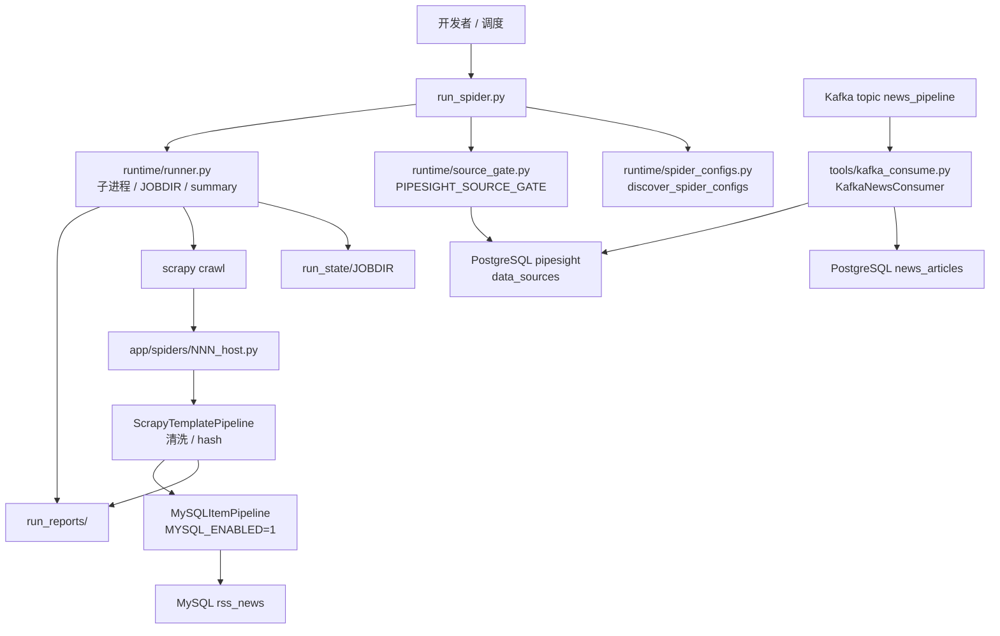
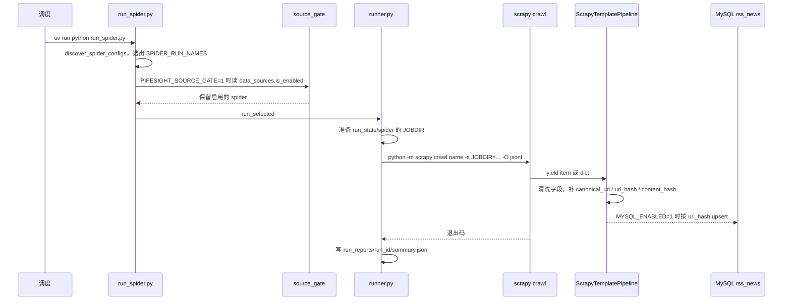

# news-pipelines

`news-pipelines` 是一套基于 Scrapy 的多站点新闻采集程序，覆盖管道运营商、能源与工业技术、政府与政策机构等站点。Python `>=3.12`，依赖由 `uv` 锁定。统一入口是 `run_spider.py`：它发现 `app/spiders/` 下的扁平站点 spider，按需经过 pipe-sight 的数据源门控，再以子进程执行 `scrapy crawl`。

它是 [pipe-sight](https://github.com/liuxu6014/pipe-sight) 的上游采集端。两边约定共享 PostgreSQL 库（默认库名 `pipesight`）里的 `data_sources`、`news_articles`，以及 Kafka topic 名 `news_pipeline`。本仓库目前实现的是：读取 `data_sources` 做启停门控、把 spider 种子写进这张表、以及**消费** `news_pipeline` 写入 `news_articles`。抓取进程本身不向 Kafka 发布消息。

`pyproject.toml` 里的包名仍是 `scrapy-template`。Scrapy 工程名（`scrapy.cfg` 的 `project`、`BOT_NAME`）是 `app`。GitHub 仓库名是 `news-pipelines`。

## 1. 项目概述

| 项目项 | 说明 |
| --- | --- |
| 仓库 | `news-pipelines` |
| 运行入口 | `run_spider.py` |
| 包管理 | `uv`，`requires-python >=3.12` |
| 爬虫框架 | Scrapy `>=2.16` |
| 默认采集范围 | `app/spiders/NNN_<host>.py`，编号 `001`–`150`，共 150 个站点 spider；`example` 不在默认清单里 |
| 抓取产物 | `run_reports/items/<spider>.jsonl`，以及 `run_reports/<run_id>/summary.json` |
| 断点 | 每个 spider 的 Scrapy `JOBDIR` 在 `run_state/<spider>/` |
| 可选 MySQL | `MYSQL_ENABLED=1` 时，`MySQLItemPipeline` 按 `url_hash` upsert 已存在的 `rss_news` |
| 可选 PostgreSQL | 只服务于 Kafka 消费者和数据源门控，不挂在 Scrapy 抓取 pipeline 上 |
| 监控 | `spider-monitor[scrapy]`，扩展在 `app/extensions/spider_monitor.py` |

`example` 仍抓取 `https://quotes.toscrape.com/`，用来检查 Scrapy 工程能不能跑起来。日常批量采集走 150 个站点 spider。

## 2. 与 pipe-sight 的关系

代码里把对方称为 pipe-sight（源码注释里的本地路径是 `D:\A_CODEBASE\pipe-sight`）。公开仓库是 <https://github.com/liuxu6014/pipe-sight>。本仓库能对上的共享约定如下。

| 共享对象 | 本仓库实际怎么用 |
| --- | --- |
| PostgreSQL `data_sources` | `tools/seed_data_sources.py` 为每个站点 spider 幂等写入一行，`adapter='news_pipelines_spider'`，匹配键是 `config.spider_name`。`PIPESIGHT_SOURCE_GATE=1` 时，`run_spider.py` 只跑 `is_enabled=true` 的 spider |
| PostgreSQL `news_articles` | `tools/kafka_consume.py` 在 `PG_ENABLED=1` 时，把 Kafka 消息 upsert 进去。抓取 pipeline **不会**写这张表 |
| Kafka topic `news_pipeline` | 只作为消费者的默认 topic（`KAFKA_TOPIC`，默认 `news_pipeline`）。本仓库没有 producer |

门控细节在 `app/runtime/source_gate.py`：

- 默认关闭。只有 `PIPESIGHT_SOURCE_GATE=1` 才查询数据库。
- 查询条件是 `adapter = 'news_pipelines_spider'`，读取 `config->>'spider_name'` 和 `is_enabled`。
- 没有对应行时，默认仍允许运行（`PIPESIGHT_SOURCE_GATE_ALLOW_UNKNOWN=1`）。设为 `0` 后，未登记的 spider 会被跳过，日志原因是 `not_in_pipesight`。
- 已登记且 `is_enabled=false` 的 spider 被跳过，原因是 `disabled_in_pipesight`。
- 连接或查询失败时回退为运行全部已选 spider，日志是 `PIPESIGHT_SOURCE_GATE_FAILED`。
- 门控使用 `PG_HOST` / `PG_PORT` / `PG_DATABASE` / `PG_USER` / `PG_PASSWORD` / `PG_CONNECT_TIMEOUT`。它不看 `PG_ENABLED`。`PG_ENABLED` 只控制消费者是否允许写库。

种子脚本 `tools/seed_data_sources.py`：

```bash
uv run python tools/seed_data_sources.py --dry-run
uv run python tools/seed_data_sources.py
uv run python tools/seed_data_sources.py --reactivate
```

每行写入 `name`（`site_name`）、`type`（`website`，微信域名时为 `wechat`）、`url`（`entry_url`）、`adapter='news_pipelines_spider'`、`config`（`spider_name`、`site_id`、`site_type`、`language`）。`cron` 与 `next_run_at` 写 `NULL`，调度留在本仓库的 `run_spider.py`。重复执行会更新名称和 URL，并保留管理员已经改过的 `is_enabled`；`--reactivate` 才把停用的来源重新打开。表由 pipe-sight 侧维护，本仓库没有 `data_sources` 的迁移脚本。

字段级契约见 [docs/database-contract.md](docs/database-contract.md)。

## 3. 运行架构



抓取链路和 Kafka 消费链路是分开的。抓取结果停在 JSONL 和可选的 MySQL `rss_news`。`news_articles` 只由消费者写入。



## 4. 技术栈

| 分类 | 技术 |
| --- | --- |
| 语言 | Python 3.12+（`.python-version` 为 `3.12`） |
| 爬虫 | Scrapy 2.16+。站点 spider 使用 `async def start()`，不再依赖已停用的 `start_requests` |
| 包管理 | uv，锁文件 `uv.lock` |
| 配置 | python-dotenv，读取项目根目录 `.env` |
| HTTP 变体 | `curl_cffi`（`CURL_CFFI_HOSTS`）、Playwright（`PLAYWRIGHT_HOSTS`）。未命中白名单的请求仍走 Scrapy 下载器 |
| MySQL | PyMySQL，表默认 `rss_news` |
| PostgreSQL | psycopg2，库默认 `pipesight`，表默认 `news_articles` |
| Kafka | `kafka-python`。仓库里只有 `KafkaConsumer` / `KafkaAdminClient` |
| 监控 | spider-monitor `0.2.2` 的 Scrapy extra |
| 测试 | `unittest`。`pytest` 在 dev 依赖里，CI 跑的是 unittest |
| 检查 | ruff、pip-audit |
| 容器 | `Dockerfile`，基础镜像 `python:3.12-slim`，非 root 用户 `appuser` |
| CI | `.github/workflows/test.yml`，Windows 与 Ubuntu |

## 5. 目录结构

```text
news-pipelines/
├── run_spider.py                  # CLI：发现 spider、门控、调用 runner
├── scrapy.cfg                     # default settings = app.settings，project = app
├── pyproject.toml                 # 包名仍为 scrapy-template
├── uv.lock
├── .python-version                # 3.12
├── .env.example                   # 环境变量模板；复制为 .env，不要提交 .env
├── Dockerfile
├── .dockerignore
├── .github/workflows/test.yml
├── docs/
│   ├── database-contract.md       # rss_news 与 news_articles / data_sources 契约
│   ├── project-overview.md        # 较早的模块边界说明，和当前代码有差距
│   ├── mcp-usage.md
│   ├── api_discovery.md
│   ├── gov-news-integration.md
│   ├── gov_news_scrapy.md
│   ├── gov_news_frontend_style.md
│   ├── site_spiders_manifest.json
│   └── site_spiders_manifest.txt
├── migrations/mysql/
│   └── 001_create_rss_news.sql    # 仅 MySQL 示例；没有 PostgreSQL 迁移
├── app/
│   ├── settings.py                # Scrapy 全局设置和 .env 映射
│   ├── items.py                   # ScrapyTemplateItem
│   ├── pipelines.py               # 清洗、MySQL upsert、news_articles upsert
│   ├── middlewares.py             # SSRF、curl_cffi、Playwright、可选代理池
│   ├── item_deduplication.py      # canonical_url、url_hash、content_hash
│   ├── html_markdown.py           # 详情 HTML 转 Markdown
│   ├── runtime/
│   │   ├── runner.py              # 子进程、JOBDIR、run_reports
│   │   ├── spider_configs.py      # 自动发现与校验
│   │   ├── source_gate.py         # data_sources 启停门控
│   │   ├── kafka_consumer.py      # KafkaNewsConsumer
│   │   ├── spider_quality.py      # 时间、乱码、质量报告辅助
│   │   ├── curl_http.py
│   │   └── playwright_http.py
│   ├── spiders/
│   │   ├── NNN_<host>.py          # 150 个自包含站点 spider
│   │   ├── example.py             # quotes.toscrape.com，不在默认清单
│   │   └── source_availability.py # 探测记录，不是 spider，运行时不读取
│   ├── extensions/spider_monitor.py
│   └── monitors/quality_rules.py
├── tools/
│   ├── seed_data_sources.py
│   ├── kafka_consume.py
│   ├── validate_spider_configs.py
│   ├── build_spider_configs.py
│   ├── watch_spiders.py
│   ├── verify_extract.py
│   ├── verify_sources.py
│   ├── discover_source_endpoints.py
│   ├── probe_pagination.py
│   ├── probe_site_apis.py
│   ├── generate_xpath_spiders.py
│   ├── generate_sitemap_spiders.py
│   ├── generate_wp_spiders.py
│   └── export_us_government_frontend_data.py
└── tests/                         # unittest，覆盖选择、JOBDIR、MySQL、Postgres、Kafka、门控
```

本地运行目录不提交：

- `run_state/`：Scrapy `JOBDIR`。
- `run_reports/`：JSONL、summary、MySQL/PostgreSQL dead letter。
- `.env`：本地密钥。
- `.venv/`、`.codegraph/`、`.scrapy/`、`httpcache/`。

`docs/project-overview.md` 仍按早期模板描述模块图，没有 source gate 和 Kafka 消费者。运行事实以本文和代码为准。

## 6. 主运行流程

### 6.1 发现与默认清单

`run_spider.py` 在导入时调用 `discover_spider_configs(include_example=True)`。发现逻辑只收录直接放在 `app/spiders/` 下、且被 Scrapy spider loader 注册的类。`SPIDER_CONFIGS` 的字段来自 spider 类属性：`name`、`site_name`、`site_type`、`language`、`entry_url`、`section_urls`、`start_urls`，另外带上 `jobdir=run_state/<name>`、空的 `settings`、`timeout_seconds=0`。

`SPIDER_RUN_NAMES` 是其中除 `example` 以外的全部 name，按名字排序。因此不带参数执行 `run_spider.py` 会尝试跑满 150 个站点 spider。

`timeout_seconds=0` 表示 runner 不给子进程加超时。站点自己的下载超时写在 spider 的 `custom_settings` 里。

### 6.2 选择与门控

常用参数：

```bash
uv run python run_spider.py --dry-run
uv run python run_spider.py --spider 059_nhc_gov_cn
uv run python run_spider.py --spider 120_zgznh_com --spider 059_nhc_gov_cn
uv run python run_spider.py --limit 5 --offset 0
uv run python run_spider.py --skip example
uv run python run_spider.py --available-only
uv run python run_spider.py --fresh --spider 059_nhc_gov_cn
uv run python run_spider.py --resume --spider 059_nhc_gov_cn
uv run python run_spider.py --stop-on-failure
uv run python run_spider.py --setting DOWNLOAD_DELAY=1
uv run python run_spider.py --allow-empty
```

`--spider` 覆盖默认清单。`--skip` 可按 name、标题、URL、文件路径或 glob 排除。`--available-only` 会再跑一次 `scrapy list`，丢掉当前解释器加载不到的名字。选中列表再交给 `select_enabled()`。dry-run 在门控之后返回，不启动子进程；一个 spider 都没选中时退出码是 `66`，除非加了 `--allow-empty`。

### 6.3 子进程、JOBDIR、报告

`app/runtime/runner.py` 对每个 spider：

1. 把 `JOBDIR` 解析到项目内的 `run_state/<spider>`。路径逃出 `run_state/` 会直接报错。
2. `--fresh` 时删掉旧目录再创建；默认保留目录，Scrapy 按 JOBDIR 续跑。`--resume` 与默认行为相同，只是和 `--fresh` 互斥。
3. 执行 `python -m scrapy crawl <name> -s JOBDIR=... -O run_reports/items/<name>.jsonl`。
4. 额外传入 `-a output=run_reports/<run_id>/raw/<name>.json`。当前站点 spider 不写这个文件；runner 只在文件存在且 `reason` 为 `closespider_timeout` 时把它记成失败。
5. 用 JSONL 行数作为 item 计数，写出：

```text
run_reports/
├── items/
│   └── 059_nhc_gov_cn.jsonl
└── <run_id>/
    ├── summary.json
    └── spiders/
        └── 059_nhc_gov_cn.json
```

`--output-dir` 与 `--summary-dir` 可以改这两处位置。默认分别是 `run_reports/items` 和 `run_reports`。

### 6.4 清洗与 MySQL

`ITEM_PIPELINES` 只有两项：

| 优先级 | 类 | 作用 |
| --- | --- | --- |
| 300 | `ScrapyTemplatePipeline` | 去掉文本空白；有 URL 时补 `canonical_url`、`source_site`、`source_category`、`content_preview`、`crawled_at`，并用 `item_deduplication.item_hashes()` 写 `url_hash` / `content_hash`。能解析的 `publish_time` 先规范成 `YYYY-MM-DD HH:MM` |
| 850 | `MySQLItemPipeline` | `MYSQL_ENABLED=1` 时批量 `INSERT ... ON DUPLICATE KEY UPDATE`，主键是 `url_hash` |

站点 spider 多数 `yield` 普通 dict，`example` yield `ScrapyTemplateItem`。pipeline 用 ItemAdapter，两种都能接。

`DROP_ITEM_WITHOUT_URL` 默认关闭。打开后，没有 URL 的 item 会在清洗阶段被丢掉。

MySQL 默认关闭，项目不建表。开启前执行 `migrations/mysql/001_create_rss_news.sql`。`publish_time` 在写入行时再转成 MySQL `DATETIME(3)` 字符串（`YYYY-MM-DD HH:MM:SS.fff`），解析不了则为 `NULL`。失败批次写到 `run_reports/mysql_dead_letters/`；完整行只有 `MYSQL_DEAD_LETTER_INCLUDE_ROWS=1` 才落盘。

`NewsArticlesPipeline` 实现了 `from_crawler()`，但没有放进 `ITEM_PIPELINES`。抓取过程即使 `PG_ENABLED=1` 也不会写 `news_articles`。

### 6.5 下载中间件

`app/middlewares.py` 里启用了四层 downloader middleware：

- `ScrapyTemplateDownloaderMiddleware`：默认 `SSRF_PROTECTION_ENABLED=true`，拦截 private、loopback、link-local、reserved、multicast。需要放行时设置 `SSRF_ALLOWED_HOSTS`，或在 spider 的 `custom_settings` 里写本站域名。很多站点 spider 已经放行了自己的域名，避免保留地址段上的误判。
- `CurlCffiDownloaderMiddleware`：主机命中 `CURL_CFFI_HOSTS` 时改用 Chrome TLS 指纹。
- `PlaywrightRenderMiddleware`：主机命中 `PLAYWRIGHT_HOSTS` 时用浏览器渲染。个别政府站在 `custom_settings` 里打开了这项。
- `RotatingProxyMiddleware`：只有设置了 `CRAWLER_PROXY_POOL`（逗号分隔的代理 URL）才会启用，否则 Scrapy 以 `NotConfigured` 卸掉它。`.env.example` 没有这项。

全局默认：`ROBOTSTXT_OBEY=True`，`CONCURRENT_REQUESTS=16`，`CONCURRENT_REQUESTS_PER_DOMAIN=8`，`DOWNLOAD_DELAY=0.5`，AutoThrottle 开启，retry 覆盖 `408/429/5xx`。单个 spider 的 `custom_settings` 会覆盖这些值。

## 7. Kafka 与 PostgreSQL

### 7.1 本仓库没有 producer

在 `app/`、`tools/`、`tests/` 和配置里搜索不到 Kafka producer，也没有把抓取 item 发到 topic 的调用。`run_spider.py` 不会连接 Kafka。

因此当前抓取结果的去向是：

- `run_reports/items/<spider>.jsonl`
- `run_reports/<run_id>/summary.json` 与 `spiders/<spider>.json`
- `MYSQL_ENABLED=1` 时的 MySQL `rss_news`

这些数据不会进入 `news_pipeline`。topic 名只存在于消费者默认值 `KAFKA_TOPIC=news_pipeline`。如果下游对接说明要求本爬虫把新闻发布到该 topic，发布端不在本仓库。

### 7.2 消费者：topic 到 `news_articles`

`tools/kafka_consume.py` 构造 `app.runtime.kafka_consumer.KafkaNewsConsumer`，用 `app.pipelines.NewsArticlesPipeline` 写入 PostgreSQL。

```bash
uv run python tools/kafka_consume.py --dry-run --max-messages 5
uv run python tools/kafka_consume.py
uv run python tools/kafka_consume.py --max-messages 1000
uv run python tools/kafka_consume.py --ensure-topic --topic news_pipeline
```

行为：

- 非 dry-run 且 `PG_ENABLED` 不是真值时，直接报错并退出。dry-run 只打印映射结果，不写库、不提交 offset。
- `KAFKA_BOOTSTRAP_SERVERS` 为空时，CLI 回退到 `localhost:9092`。这是 `KafkaNewsConsumer.DEFAULT_BOOTSTRAP_SERVERS`，不是一套内置的远程集群地址。
- 默认 topic `news_pipeline`，默认 group `news-pipelines-rss-consumer`（名字还留着 rss，写入目标已经是 PostgreSQL `news_articles`），`auto.offset.reset=earliest`，关闭 auto commit。
- 消息是 JSON。`title`、`url`、`content_md` 三者缺一则整条跳过。`ctime` 为 Unix 秒时写成 `published_at`。`content` 为空时用 `content_md` 填充。
- `source_id` 先按 `data_sources.name = site_name` 找，再按 `url LIKE '%domain%'` 找。都没有就 `INSERT` 一行 `adapter='kafka'` 的 `data_sources`。这和种子脚本的 `adapter='news_pipelines_spider'`、`config.spider_name` 不是同一套键。
- Upsert 语句是 `INSERT ... ON CONFLICT (md5(url)) DO UPDATE`，更新标题、作者、时间、正文等，不覆盖 `source_id`、`url`、`is_pushed`。
- offset 在对应批次 `flush` 成功后提交。中途崩溃会重放未提交记录（at-least-once）。
- `--ensure-topic` 用 `KafkaAdminClient` 建 topic，已存在则忽略。

死信目录默认 `run_reports/pg_dead_letters/`。

### 7.3 双写风险

抓取进程写的是 MySQL `rss_news`（而且默认关闭），消费者写的是 PostgreSQL `news_articles`。两张表不是同一个库。

风险在 PostgreSQL 这一侧：本仓库的消费者和 pipe-sight 如果同时写 `news_articles`，会打到同一个 `md5(url)` 唯一索引上，后写的一方覆盖标题、作者、`published_at`、正文和 `category_id`。消费者还可能插入 `adapter='kafka'` 的 `data_sources` 行；若 `site_name` 和种子行的 `name` 对不上，目录里会出现第二条来源，门控仍然只认 `news_pipelines_spider`。

在发布端补齐之前，不要把本消费者当成抓取结果进入 pipe-sight 的通道，也不要和 pipe-sight 自己的 `news_articles` 写入同时开着，除非已经确认只有一方负责这张表。

## 8. 本地运行

### 8.1 安装

需要 Python 3.12+ 和 uv。MySQL、PostgreSQL、Kafka、Docker 都是可选的。

```bash
uv sync
uv run scrapy list
uv run python tools/validate_spider_configs.py --check-available
uv run python run_spider.py --dry-run
```

`scrapy list` 应能看到 `example` 和 `001_` 到 `150_` 的站点名。dry-run 在默认清单上会打印选中的 150 个 spider；门控关闭时不会连数据库。

先跑示例，确认链路：

```bash
uv run python run_spider.py --spider example
```

### 8.2 环境变量

```bash
cp .env.example .env
```

权威列表是 `.env.example` 和 `app/settings.py`。下面只列代码里真实读取的项。

```dotenv
LOG_LEVEL=INFO
HTTPCACHE_ENABLED=false
SSRF_PROTECTION_ENABLED=true
SSRF_ALLOWED_HOSTS=

MYSQL_ENABLED=0
MYSQL_HOST=127.0.0.1
MYSQL_PORT=3306
MYSQL_DATABASE=crawler
MYSQL_USER=root
MYSQL_PASSWORD=
MYSQL_TABLE=rss_news
MYSQL_CHARSET=utf8mb4
MYSQL_CONNECT_TIMEOUT=10
MYSQL_BATCH_SIZE=100
MYSQL_FAIL_ON_ERROR=1
MYSQL_DEAD_LETTER_INCLUDE_ROWS=0
MYSQL_MAX_FAILED_BATCHES=20
MYSQL_RETRY_TIMES=0
MYSQL_RETRY_BACKOFF_SECONDS=1.0

PG_ENABLED=0
PG_HOST=127.0.0.1
PG_PORT=5432
PG_DATABASE=pipesight
PG_USER=postgres
PG_PASSWORD=
PG_TABLE=news_articles
PG_CONNECT_TIMEOUT=10
PG_BATCH_SIZE=100
PG_FAIL_ON_ERROR=1
PG_DEAD_LETTER_INCLUDE_ROWS=0
PG_MAX_FAILED_BATCHES=20
PG_RETRY_TIMES=0
PG_RETRY_BACKOFF_SECONDS=1.0

PIPESIGHT_SOURCE_GATE=0
PIPESIGHT_SOURCE_GATE_ALLOW_UNKNOWN=1

KAFKA_BOOTSTRAP_SERVERS=
KAFKA_TOPIC=news_pipeline
KAFKA_GROUP_ID=news-pipelines-rss-consumer
KAFKA_AUTO_OFFSET_RESET=earliest
KAFKA_SECURITY_PROTOCOL=
KAFKA_SASL_MECHANISM=
KAFKA_SASL_USERNAME=
KAFKA_SASL_PASSWORD=
KAFKA_COMMIT_INTERVAL_MSGS=100

SPIDER_MONITOR_ENABLED=1
SPIDER_MONITOR_PROJECT=app
SPIDER_MONITOR_ENV=local
SPIDER_MONITOR_ENDPOINT=
SPIDER_MONITOR_FAIL_ON_ERROR=0
SPIDER_MONITOR_MIN_ITEMS=0
SPIDER_MONITOR_MAX_DROPPED=0
SPIDER_MONITOR_MAX_SPIDER_ERRORS=0
SPIDER_MONITOR_MAX_DB_ERRORS=0
SPIDER_MONITOR_FAIL_ON_QUALITY_ERROR=0
```

`.env.example` 里还有 `SPIDER_MONITOR_OWNER`、`SPIDER_MONITOR_OWNER_EMAIL`、`SPIDER_MONITOR_OWNER_PHONE`、`SPIDER_MONITOR_OWNER_TEAM`、`SPIDER_MONITOR_FIELD_ALLOWLIST`。`SPIDER_MONITOR_ENV` 不是 `local`、`dev`、`development`、`test` 时，非空的 `SPIDER_MONITOR_ENDPOINT` 必须是 HTTPS，否则扩展以 `NotConfigured` 退出。

代码另外读取、但没有写进 `.env.example` 的项：

| 变量 | 默认 | 作用 |
| --- | --- | --- |
| `CURL_CFFI_HOSTS` | 空 | 逗号分隔主机，命中后走 curl_cffi |
| `CURL_CFFI_CONCURRENCY_PER_HOST` | `2` | |
| `CURL_CFFI_DELAY_SECONDS` | `0.5` | |
| `PLAYWRIGHT_HOSTS` | 空 | 逗号分隔主机，命中后走 Playwright |
| `PLAYWRIGHT_CONCURRENCY_PER_HOST` | `1` | |
| `PLAYWRIGHT_CHANNEL` | `chrome` | |
| `CRAWLER_PROXY_POOL` | 空 | 非空才启用轮换代理 |
| `CRAWLER_PROXY_MAX_ATTEMPTS` | `3` | |
| `DROP_ITEM_WITHOUT_URL` | 关闭 | 清洗阶段丢掉无 URL 的 item |
| `MYSQL_DEAD_LETTER_DIR` / `PG_DEAD_LETTER_DIR` | `run_reports` 下对应目录 | |

布尔值接受 `1/true/yes/on`。

### 8.3 接入 pipe-sight 的启停

1. `.env` 里填好能连到 pipe-sight 库的 `PG_HOST`、`PG_PORT`、`PG_DATABASE`、`PG_USER`、`PG_PASSWORD`。这一步不需要 `PG_ENABLED=1`。
2. `uv run python tools/seed_data_sources.py --dry-run` 看将要写入的 spider。
3. 去掉 `--dry-run` 写入 `data_sources`。
4. 在 pipe-sight 里切换 `is_enabled`。
5. 设置 `PIPESIGHT_SOURCE_GATE=1` 后再跑 `run_spider.py`。

### 8.4 开启 MySQL

```sql
CREATE DATABASE crawler CHARACTER SET utf8mb4 COLLATE utf8mb4_unicode_ci;
```

```bash
mysql -h 127.0.0.1 -u root -p crawler < migrations/mysql/001_create_rss_news.sql
```

然后 `MYSQL_ENABLED=1` 并填写 `MYSQL_*`，再运行 spider。这只写 `rss_news`，不会出现在 pipe-sight 的 `news_articles` 里。

## 9. 站点覆盖与质量现状

150 个站点 spider 都是单文件、自包含脚本，直接继承 `scrapy.Spider`，不继承项目级基类。`site_type` / `source_category` 的分布是：

| `site_type` | 站点数 | `source_category` |
| --- | --- | --- |
| `gov` | 75 | 政策机构 |
| `tech` | 18 | 国外技术服务 |
| `pipe` | 17 | 国际管道 |
| `robot` | 7 | 机器人 |
| `energy` | 6 | 新能源 |
| `smart` | 6 | 智能化 |
| `inspect` | 6 | 管道检测新技术有关专业网站 |
| `elec` | 5 | 电气 |
| `ip` | 4 | 知识产权与对外交流 |
| `compressor` | 2 | 压缩机组相关 |
| `standard` | 2 | 标准化管理 |
| `pump` | 1 | 泵机组 |
| `pipeline` | 1 | 管道技术 |

抓取方式并不统一：一部分走列表/详情 XPath，一部分直连 sitemap.xml，6 个走 WordPress REST（`004`、`013`、`014`、`027`、`028`、`036`），`034_snam_it` 用 sitemap 加 AEM `.model.json`，`037_energytransfer_com` 用站内 JSON newsroom。正文 HTML 转 Markdown 用 `app/html_markdown.py`。

质量上还不能把 150 个 spider 当成都已验收：

- 125 个文件定义了 `LIST_ITEM_XPATH`。33 个写了站点选择器并在解析里使用；91 个在解析里读到的仍是空字符串，`_iter_links()` 于是退回页面上全部 `//a[@href]`，再用 `DETAIL_PATTERNS` 或「`.html` 且 URL 里带日期 / `content` / `art`」来猜详情页。`133_std_samr_gov_cn.py` 另有一处空字符串常量，解析函数不读它。
- 52 个文件的 `DETAIL_CONTENT_XPATH`、53 个文件的 `DETAIL_PATTERNS` 仍是空元组，正文和详情判断主要靠文件里那组通用 XPath。
- 121 个文件头仍写着「XPath 选择器为初始值，需按站点实际页面结构微调后再投入长期采集」。
- `app/spiders/source_availability.py` 记录了探测时被反爬挡住或没有公开新闻源的站点名称。`run_spider.py` 不读这个文件，这些名字只要仍是 spider 就会进入默认清单。

上线某个站点前，用小范围命令看 JSONL 里是否真有标题、时间和正文，而不是只看进程退出码：

```bash
uv run python run_spider.py --fresh --spider 059_nhc_gov_cn
uv run python tools/verify_extract.py
uv run python tools/verify_sources.py
```

`verify_extract.py` 和 `verify_sources.py` 会访问外网，并把报告写到 `run_reports/`。

## 10. 开发、测试与部署

### 10.1 新增 spider

1. 在 `app/spiders/` 增加 `NNN_<host>.py`，类继承 `scrapy.Spider`，`name` 唯一，并设置 `site_id`、`site_name`、`site_type`、`language`、`entry_url`、`section_urls`、`start_urls`。
2. 站点差异放在该类的 `custom_settings`，不要改全局 `SPIDER_CONFIGS`。发现逻辑会把配置里的 `settings` 留空。
3. 生成器 `tools/generate_xpath_spiders.py`、`generate_sitemap_spiders.py`、`generate_wp_spiders.py` 只负责产出初稿，生成后仍要按真实页面改选择器或接口。

```bash
uv run scrapy list
uv run python tools/validate_spider_configs.py --check-available
uv run python run_spider.py --dry-run --spider <name>
```

改入库字段时要同时改 `app/items.py`、`MySQLItemPipeline` 的列、`migrations/mysql/001_create_rss_news.sql`、`docs/database-contract.md` 和 `tests/test_mysql_pipeline.py`。`news_articles` 的列在 `NewsArticlesPipeline.COLUMNS`，表本身不由本仓库迁移。

### 10.2 检查命令

```bash
uv run python -m unittest discover -s tests -v
uv run python -m compileall run_spider.py app tools tests
uv run python tools/validate_spider_configs.py --check-available
uv run python run_spider.py --dry-run
uv run --with ruff ruff check run_spider.py app tools tests
uv run --with pip-audit pip-audit
```

现有测试覆盖配置发现与校验、spider 选择、JOBDIR、SSRF 中间件、URL hash、MySQL pipeline、`NewsArticlesPipeline`、Kafka 消费者和 source gate。

### 10.3 Docker 与定时任务

```bash
docker build -t scrapy-template:local .
docker run --rm scrapy-template:local python run_spider.py --dry-run
```

镜像 `CMD` 是 `python run_spider.py`，不带参数时会跑默认的 150 个 spider。挂载本地状态：

```bash
docker run --rm \
  --env-file .env \
  -v "$(pwd)/run_state:/app/run_state" \
  -v "$(pwd)/run_reports:/app/run_reports" \
  scrapy-template:local \
  python run_spider.py --spider example
```

`/app/run_state` 和 `/app/run_reports` 是 volume。依赖安装命令是 `uv sync --locked --no-dev`。

示例 crontab：

```cron
0 * * * * cd /path/to/news-pipelines && /usr/local/bin/uv run python run_spider.py --stop-on-failure >> run_reports/cron.log 2>&1
```

CI 在 Windows 和 Ubuntu 上执行 `uv sync --locked`、ruff、pip-audit、unittest、compileall、配置校验和 `--dry-run`。

## 11. 已知缺口

- 没有 Kafka producer。抓取结果到不了 `news_pipeline`，pipe-sight 也看不到这次抓取写进 `news_articles`。
- `PG_ENABLED` 不把 `NewsArticlesPipeline` 接到 Scrapy。它只放行 `tools/kafka_consume.py`。
- 消费者和 pipe-sight 若同时写 `news_articles`，以及消费者自动插入 `adapter='kafka'` 的 `data_sources`，会和 `news_pipelines_spider` 种子行分叉。见第 7.3 节。
- 91 个 XPath spider 的列表选择器仍是空的，121 个文件仍标明选择器是初始值。默认全量跑会包含这些站。
- `pyproject.toml` 的包名还是 `scrapy-template`；Kafka group 默认名还是 `news-pipelines-rss-consumer`。
- `docs/project-overview.md` 没有跟上 source gate 和 Kafka 消费者。

## 附录：常用命令

```bash
uv sync
uv run scrapy list
uv run python tools/validate_spider_configs.py --check-available
uv run python run_spider.py --dry-run
uv run python run_spider.py --spider example
uv run python run_spider.py --limit 5 --offset 0
uv run python tools/seed_data_sources.py --dry-run
uv run python tools/kafka_consume.py --dry-run --max-messages 5
uv run python -m unittest discover -s tests -v
uv run python -m compileall run_spider.py app tools tests
uv run --with ruff ruff check run_spider.py app tools tests
docker build -t scrapy-template:local .
docker run --rm scrapy-template:local python run_spider.py --dry-run
```

## 参考文档

- [数据库契约](docs/database-contract.md)
- [架构补充](docs/project-overview.md)（模块图早于当前门控和 Kafka 消费者）
- [MCP 使用说明](docs/mcp-usage.md)
- [Agent 项目规则](AGENTS.md)
