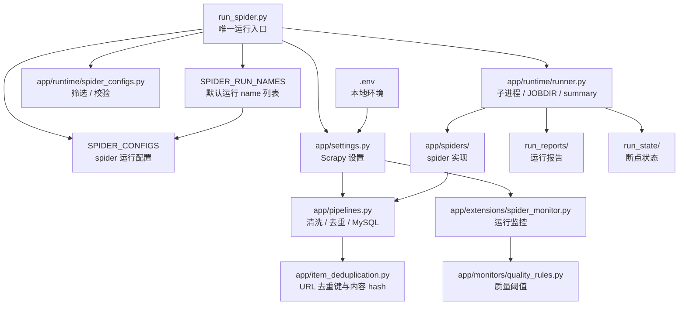
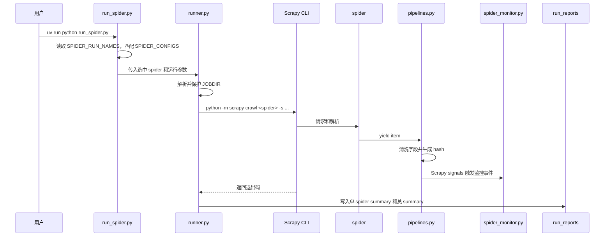

# 架构补充

本文档只补充 `app` 的模块关系和边界。日常使用、命令、字段示例和破甲提示词以 [README.md](../README.md) 为主。

## 运行总览



## 模块职责

| 路径 | 现役职责 |
| --- | --- |
| `run_spider.py` | 运行入口，只维护 `SPIDER_RUN_NAMES`、`SPIDER_CONFIGS` 和 CLI |
| `app/runtime/spider_configs.py` | 配置筛选、可用 spider 发现、配置校验 |
| `app/runtime/runner.py` | JOBDIR 安全、Scrapy 子进程命令、日志、summary |
| `app/settings.py` | Scrapy 全局设置，从 `.env` 读取本地差异 |
| `app/spiders/` | 具体站点 spider |
| `app/items.py` | 通用 item 字段 |
| `app/pipelines.py` | 字段清洗、URL/content hash、可选 MySQL upsert |
| `app/item_deduplication.py` | URL 规范化、追踪参数剔除、URL 去重键、内容 hash |
| `app/extensions/spider_monitor.py` | Scrapy signal 到 spider-monitor 的适配层 |
| `app/monitors/quality_rules.py` | 运行质量阈值判断 |
| `tools/` | 配置候选、配置校验、文件监听等开发辅助 |

## 运行时序



## 配置边界

| 内容 | 权威位置 |
| --- | --- |
| 默认运行哪些 spider | `run_spider.py` 的 `SPIDER_RUN_NAMES` |
| 单个 spider 的运行差异 | `run_spider.py` 的 `SPIDER_CONFIGS` |
| 本地环境、数据库、日志、监控开关 | `.env` |
| Scrapy 全局默认行为 | `app/settings.py` |
| 复用逻辑 | `app/` 包内模块 |
| 开发辅助命令 | `tools/` |
| Agent 工作流 | `.codex/skills/` |
| MCP 注册 | `.codex/config.toml` |

原则：同一事实只保留一个权威位置。README 面向使用者，本文档面向接手者理解内部结构。

## 数据和状态边界

```text
Spider item
  -> ScrapyTemplatePipeline 清洗字段
  -> item_deduplication.py 生成 canonical_url / url_hash / content_hash
  -> MySQLItemPipeline 可选入库
  -> run_reports 写运行输出
```

- `run_state/` 只放 Scrapy `JOBDIR` 断点状态。
- `run_reports/` 只放运行 summary 和 item 输出。
- `.codex/mcp/`、`.codegraph/`、`.venv/` 是本地工具或索引目录，不提交。

## 扩展点

- 新增站点：新增 `app/spiders/<name>.py`，再把 `name` 配进 `run_spider.py`。
- 站点级 Scrapy 设置：写进该 entry 的 `settings` 字段。
- 通用字段或入库行为：改 `items.py`、`pipelines.py`、`item_deduplication.py`，并补测试。
- 运行监控质量规则：改 `app/monitors/quality_rules.py`。
- 数据库结构：由数据库侧或外部迁移系统维护；本项目 MySQL pipeline 只写入已存在的表。
- 开发辅助脚本：放 `tools/`；能复用的业务逻辑下沉到 `app/`。

## 维护检查

变更后至少复核：

```bash
uv run python -B run_spider.py --dry-run
uv run python -B tools/validate_spider_configs.py --check-available
uv run python -B -m unittest discover -s tests -v
```

如果改了工具、入口或共享模块，再运行：

```bash
uv run python -m compileall run_spider.py app tools tests
```
